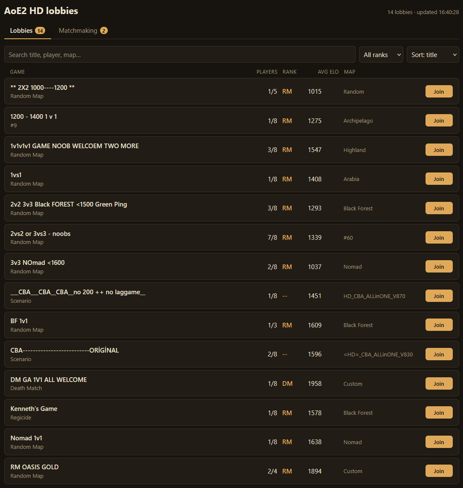
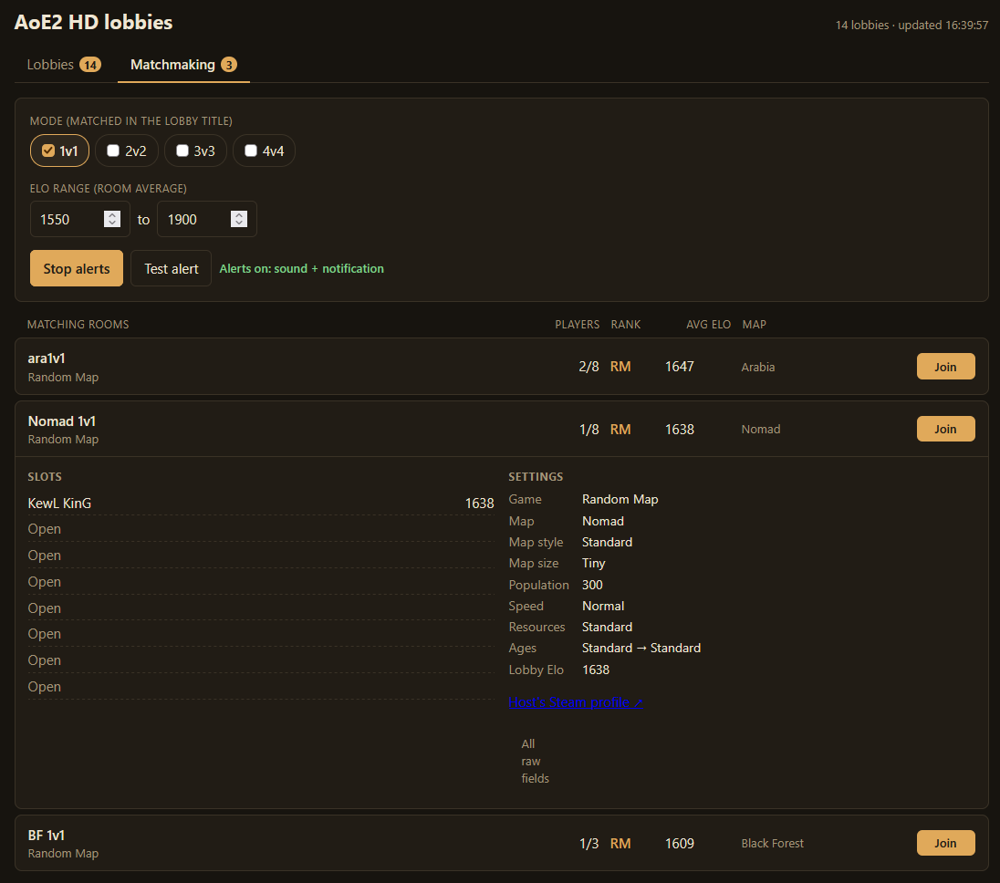
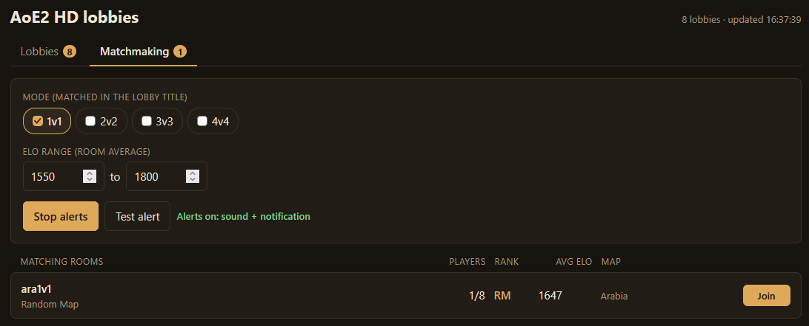

# aoe2-hd-lobby

A web page that lists Age of Empires II: HD lobbies live, without the game running,
plus a matchmaking tab that alerts you (sound + browser notification) when a room
matching your mode and ELO range opens.

It logs in to Steam as a normal client (no game, no Steam client needed), asks
Steam's matchmaking servers for AoE2 HD (app 221380) lobbies, and serves them
with FastAPI.

## Features

### Lobby list

Every public lobby with title, players, RM/DM rank, average ELO and map. Search
by title, player or map, filter by rank, and sort by title, ELO or players.
**Join** opens `steam://joinlobby/...`, so Steam launches the game straight into
that lobby on the computer viewing the page.



### Game details

Click a room to expand it: every slot with player name and ELO (or Open /
Closed / AI Player), the game settings (map, size, population, speed,
resources, ages), a link to the host's Steam profile, and all raw lobby fields.



### Matchmaking alerts

Pick 1v1–4v4 and an ELO range. A room matches when its title contains the mode
in any common spelling (`1v1`, `1 vs 1`, `1x1`, `1-v-1`…) and its average ELO is
in range; full rooms are skipped. New matches play a chime and pop a browser
notification (notifications need HTTPS or localhost). Settings are remembered
in the browser.



## Steam login (once)

The app needs a Steam account. Log in once; a refresh token is saved to
`data/steam_token.json`. **Treat that file like a password** — it is git-ignored
and never baked into the Docker image.

Approve the login in the Steam mobile app and press Enter, or type a Steam Guard code.

## Run with uv

```sh
uv sync
uv run login.py                       # once
uv run uvicorn app:app --port 8000    # http://127.0.0.1:8000
```

## Run with Docker

```sh
docker compose run --rm aoe2hd python login.py   # once; writes ./data/steam_token.json
docker compose up -d --build                     # http://127.0.0.1:8000
docker compose logs -f aoe2hd
docker compose down                              # stop everything
```

Or copy an existing `data/steam_token.json` into `./data/` instead of logging in.
On Linux hosts the container runs as uid 1000, so `./data` must be writable by it
(`sudo chown 1000:1000 data`).

The compose file runs two containers:

| Service | What |
|---|---|
| `aoe2hd` | The app (hostname and container name `aoe2hd`) |
| `cloudflared-aoe2hd` | Cloudflare Tunnel that publishes the app over HTTPS, so browser notifications work remotely |

Settings go in a `.env` file next to `docker-compose.yml` (git-ignored):

| Variable | Default | What |
|---|---|---|
| `TUNNEL_TOKEN` | — | Cloudflare Tunnel token (secret; keep it out of git) |
| `PORT` | `8000` | Host port for the app |
| `AOE_REFRESH_SECONDS` | `15` | How often the lobby list is fetched from Steam |

Without a tunnel, start only the app: `docker compose up -d aoe2hd`.

## Only one collector per token

Run the app in **one place at a time** with a given token. Two running copies
log in with the same session and keep kicking each other off; Steam then
refuses the token for a while (`InvalidPassword`). The collector retries with
backoff and recovers on its own, but don't run the local and Docker versions
side by side. Copies sharing one `data/` folder on the same machine are
prevented automatically.

## Files

| Path | What |
|---|---|
| `app.py` | FastAPI app; starts the collector, serves `/` and `/api/lobbies` |
| `collector.py` | Steam session that refreshes `data/lobbies.json`, with reconnect/backoff |
| `login.py` | One-time interactive Steam login |
| `probe.py` | Dumps one raw lobby list to `data/probe.json` (debugging) |
| `aoe2lobby/auth.py` | Steam's IAuthenticationService login flow |
| `aoe2lobby/steam_session.py` | Token logon and lobby-list requests |
| `aoe2lobby/lobby_info.py` | Decodes lobby metadata (map, rank, slots…) |
| `static/` | The page; `match.js` holds the matchmaking rules (`node static/match.test.js`) |
